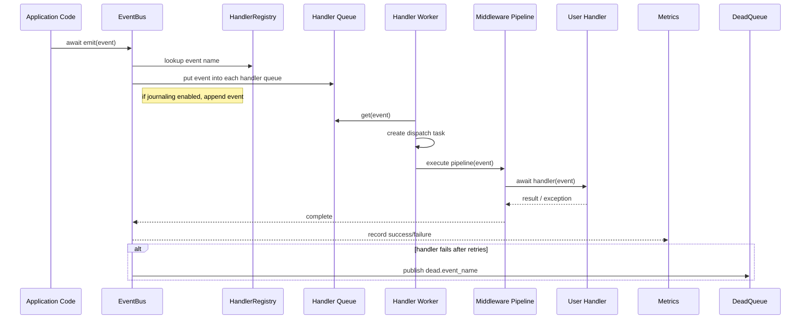

# pyeda — Detailed Codebase Explanation

This file explains the entire `pyeda` library implementation in detail for a beginner. It covers the main modules, how events and queues are created and handled, the middleware pipeline, journal persistence, metrics, UI, and configuration.

---

## 1. Library Purpose

`pyeda` is a pure-Python, in-process Event-Driven Architecture library. It provides:

- typed event definitions
- async event publishing and dispatch
- handler registration via decorator
- middleware support (logging, retry, timeout)
- optional durable journaling with SQLite
- optional live UI dashboard
- runtime metrics for event processing

It is designed to run inside a single process using Python `asyncio`.

---

## 2. Project Layout

```text
pyeda/
  pyproject.toml
  README.md
  DETAILED_CODEBASE.md
  pyeda/
    __init__.py
    bus.py
    config.py
    event.py
    exceptions.py
    handler.py
    journal.py
    metrics.py
    middleware.py
    ui.py
  tests/
    test_pyeda.py
```

### What each file contains

- `__init__.py` — exports the public API.
- `bus.py` — core `EventBus` implementation and runtime behavior.
- `config.py` — YAML/dict configuration loading and defaults.
- `event.py` — event type factory and runtime event objects.
- `exceptions.py` — error classes used across the library.
- `handler.py` — handler registration and the `@on()` decorator.
- `journal.py` — optional SQLite journal for durable event storage.
- `metrics.py` — in-memory metrics collection and snapshots.
- `middleware.py` — middleware pipeline builder and built-in middleware.
- `ui.py` — optional dashboard with HTTP/WebSocket using `aiohttp`.
- `tests/test_pyeda.py` — unit tests covering core features.

---

## 3. Main Components

### 3.1 `Event` and `BaseEvent`

- `BaseEvent` is the parent event class.
- It always contains these envelope fields:
  - `event_id` — unique string UUID
  - `emitted_at` — timestamp when event instance was created
  - `attempt` — retry attempt counter
  - `metadata` — arbitrary extra data
- `Event.define()` dynamically creates event subclasses.

Example:

```python
from pyeda import Event
VideoDownloaded = Event.define("video.downloaded", ["video_id", "local_path"])
ev = VideoDownloaded(video_id="123", local_path="/tmp/file.mp4")
```

This creates a typed class with custom payload fields and registers it under a name.

### 3.2 Event Registry

- All event types are stored in a global registry inside `pyeda.event`.
- The registry maps `event_name` strings like `"video.downloaded"` to the generated event class.
- `Event.from_dict()` reconstructs an event object from a dictionary.

This is used for journaling and replay.

---

## 4. Handler Registration and Decorator

### `pyeda.handler`

The module defines:

- `HandlerRegistration` — metadata for one handler, including its name, subscribed event, function, and concurrency limit.
- `HandlerRegistry` — stores all registered handlers for one `EventBus`.
- `on()` decorator — registers async handler functions.

### How `@on()` works

```python
@on("video.downloaded", bus=bus)
async def handle_downloaded(event):
    pass
```

- If `bus` is provided, the handler is immediately registered with that bus.
- If no `bus` is provided, the decorator stores a pending registration.
- Later, calling `bus.include_pending()` imports those pending handlers.

This supports both immediate registration and deferred registration across modules.

---

## 5. Event Bus Internals

### `pyeda.bus.EventBus`

This is the core runtime engine. Responsibilities:

- start and stop the bus
- accept events from user code
- deliver events to handler queues
- create worker tasks
- run middleware before invoking handlers
- publish dead-letter events
- optionally persist events to SQLite
- expose metrics

### Queue architecture

`EventBus` uses the following data structures:

- `_queues: Dict[str, List[asyncio.Queue]]`
  - maps each event name to one `asyncio.Queue` per handler
  - this is the fan-out path
- `_handler_queues: Dict[str, asyncio.Queue]`
  - maps each registered handler to its queue
- `_workers: List[asyncio.Task]`
  - one worker task per registered handler registration

### Why one queue per handler?

This design means:

- each handler receives every published event for its subscribed event name
- handlers do not compete for the same queue
- the bus can manage each handler separately

### Emit flow

When `bus.emit(event)` is called:

1. verify the bus is running
2. journal the event if SQLite journaling is enabled
3. look up `self._queues[event.name]`
4. put the event onto every handler queue for that event name

This makes event delivery asynchronous and non-blocking.

### Worker loop

Each worker does:

1. read an event from its assigned queue
2. if sentinel value is received, exit gracefully
3. create a dispatch task for that event
4. continue reading the next event

The worker does not block while the handler runs.

### Dispatch and middleware

Actual handler execution happens in `_dispatch()`:

- metrics `mark_active` increments active count
- build a middleware pipeline for the handler
- acquire the handler semaphore for concurrency limits
- run the pipeline, which eventually invokes the handler function
- record success or failure metrics
- update the journal status if enabled
- on final failure, publish the event to `dead.{event_name}`

### Dead-letter handling

- When a handler raises after all retries, `EventBus` considers the event dead-lettered.
- It records metrics with status `dead_lettered`.
- It emits the same event to `dead.{event_name}` if any handler subscribes to that topic.

This allows users to monitor and handle poison events separately.

---

## 6. Middleware Pipeline

### `pyeda.middleware`

The library supports composable middleware. Built-in middleware includes:

- `logging_middleware`
  - logs event dispatch start, success, and failure
- `make_retry_middleware(handler_cfg)`
  - retries handler execution on exception
  - supports fixed and exponential backoff
- `make_timeout_middleware(timeout_s)`
  - cancels a handler if it exceeds the configured timeout

### Execution order

The pipeline is built in order from outermost to innermost.
For example, `[logging, timeout, retry]` means:

1. logging wrapper enters
2. timeout wrapper enters
3. retry wrapper enters
4. actual handler runs

The middleware is bound to each event and handler using `build_pipeline_with_context()`.

---

## 7. Configuration

### `pyeda.config`

Configuration can be loaded from:

- explicit path: `EventBus.from_config("pyeda.yml")`
- dictionary: `load_config({...})`
- environment variable `PYEDA_CONFIG`
- auto-discovery files: `pyeda.yml`, `pyeda.yaml`, `.pyeda.yml`

### Config objects

The library defines dataclasses:

- `BusConfig`
  - `backend`: `memory` or `sqlite`
  - `queue_size`: queue capacity per handler
  - `journal_path`: path for SQLite journal
- `UIConfig`
  - `enabled`, `host`, `port`
- `HandlerConfig`
  - `concurrency`, `retry_attempts`, `retry_delay_s`, `retry_backoff`, `timeout_s`
- `PyEDAConfig`
  - `bus`, `ui`, `defaults`, `middleware`, `handlers`

### Per-handler override

A handler can override the defaults using the `handlers` mapping.
This is merged in `PyEDAConfig.for_handler(name)`.

Examples:

- default concurrency: `3`
- override handler `transcribe` to `1`
- set `retry_attempts` or `timeout_s` per handler

---

## 8. Durability and Journal

### `pyeda.journal`

The journal is an optional SQLite-backed persistence layer used when `backend: sqlite`.
Its purpose is durability: events survive restarts until they are delivered or dead-lettered.

### What it stores

Each event row contains:

- `event_id`
- `event_name`
- `payload` — JSON serialized event dictionary
- `status` — `pending`, `delivered`, or `dead`
- `created_at`, `updated_at`
- `attempts`
- `error`

### Journal behavior

- `append(event)` stores an event as `pending`
- `mark_delivered(event_id)` marks success
- `mark_dead(event_id, error)` marks dead-letter
- `pending_events()` returns unfinished events after restart

### Replay on startup

When the bus starts and journaling is enabled:

- it reads pending events from SQLite
- reconstructs them with `Event.from_dict`
- re-emits them into the bus

This gives a simple at-least-once delivery guarantee.

---

## 9. Metrics

### `pyeda.metrics`

The metrics collector stores:

- counts of dispatched events by name
- per-handler success/failure/dead-letter totals
- active handler counts
- average execution time
- a recent log of events

Metrics are stored in memory using a thread-safe lock.

### Snapshot API

`EventBus.stats(since_seq=0)` returns a snapshot with:

- uptime
- event counts
- handler stats
- recent activity
- max sequence number

The UI uses this snapshot to render live statistics.

---

## 10. Optional Dashboard UI

### `pyeda.ui`

This module serves a live HTML dashboard over HTTP.
It is optional because it depends on `aiohttp`.

If `aiohttp` is not installed, the UI is disabled gracefully.

### What the UI provides

- a live event count dashboard
- active handler cards
- event throughput bars
- a live event log

It communicates using WebSocket and pushes metrics snapshots every second.

### How to start

The library does not automatically start the UI in this snapshot, but the function exists:

```python
from pyeda.ui import start_ui
await start_ui(bus)
```

The UI is enabled by default in config unless `enabled: false`.

---

## 11. Error Types

`pyeda.exceptions` defines:

- `PyEDAError` — base class
- `EventNotRegisteredError` — event type lookup failure
- `HandlerError` — a handler error after retries
- `ConfigError` — invalid configuration
- `BusNotRunningError` — `emit()` called before `bus.run()`
- `DeadLetterError` — event moved to dead-letter queue

---

## 12. Event Queue and Handler Behavior

This section explains the actual queue behavior in simple terms.

### Event publishing

1. User code creates an event instance.
2. `await bus.emit(event)` is called.
3. The bus checks its internal registry for handlers.
4. The event is placed into every handler queue for that event name.

### Handler execution

- Each handler has its own `asyncio.Queue` and worker task.
- The worker consumes events one by one.
- For each event, the worker spawns a separate dispatch task.
- The dispatch task uses a semaphore to enforce concurrency.
- The handler function runs inside middleware.

### Example: Multiple handlers

If two handlers subscribe to `"video.downloaded"`, the bus creates two queues and two workers.
When the event is emitted, both queues receive the event, so both handlers run.

### Concurrency

- `queue_size` limits how many events queue up for a handler.
- `concurrency` limits how many handler executions run in parallel.
- A handler can queue many events but only execute a fixed number at once.

---

## 13. Runtime Sequence Diagram



---

## 14. Libraries Used

### Core Python libraries

- `asyncio` — async execution and queues
- `logging` — diagnostic logs
- `time` — timestamps and durations
- `dataclasses` — typed configuration and event classes
- `uuid` — unique event IDs
- `pathlib.Path` — file path handling
- `json` — serializing event payloads
- `sqlite3` — optional durable journal
- `threading.Lock` — safe metric updates across threads
- `collections.defaultdict`, `collections.deque` — metrics counting and history
- `inspect` — validating handlers are async functions
- `typing` — type annotations

### Optional libraries

- `pyyaml` — only required when loading YAML configs
- `aiohttp` — only required for the live dashboard UI

---

## 15. Test Coverage

The unit tests in `tests/test_pyeda.py` verify:

- event class creation and dictionary conversion
- bus `emit()` raising before startup
- handler receives published events
- event pipeline chaining across multiple handlers
- dead-letter behavior for failing handlers
- multiple handlers on one event
- metrics recording
- config loading from dict and per-handler overrides

---

## 16. Practical Usage Pattern

A simple pipeline looks like this:

```python
import asyncio
from pyeda import EventBus, Event, on

bus = EventBus()

VideoDownloaded = Event.define("video.downloaded", ["video_id", "local_path"])
AudioExtracted = Event.define("audio.extracted", ["video_id", "audio_path"])

@on("video.downloaded", bus=bus)
async def extract_audio(event):
    await bus.emit(AudioExtracted(video_id=event.video_id, audio_path="/tmp/audio.mp3"))

@on("audio.extracted", bus=bus)
async def handle_audio(event):
    print("audio extracted", event.audio_path)

asyncio.run(bus.run())
```

### What happens

- `bus.run()` starts the event bus and worker tasks
- events emitted with `await bus.emit(...)` are queued
- each handler receives matching events
- handlers run asynchronously and can publish new events

---

## 17. Summary

`pyeda` is a lightweight async event bus built for in-process workflows.
It is not a distributed message queue — it runs inside one Python process.

Key strengths:

- typed event definitions
- fan-out delivery to multiple handlers
- configurable retry/timeout behavior
- optional SQLite durability
- optional live dashboard

With this file, you now have a complete, beginner-friendly view of how the library is structured and how its pieces work together.
