# pyeda vs Kafka vs Celery — Diagram Heavy Architecture Guide

---

# 1. High-Level Architecture Overview

## Unified View

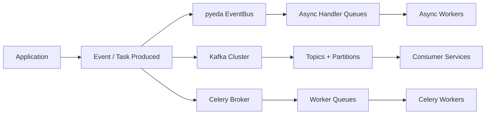

---

# 2. pyeda Architecture (In-Process Event System)

## Core Flow

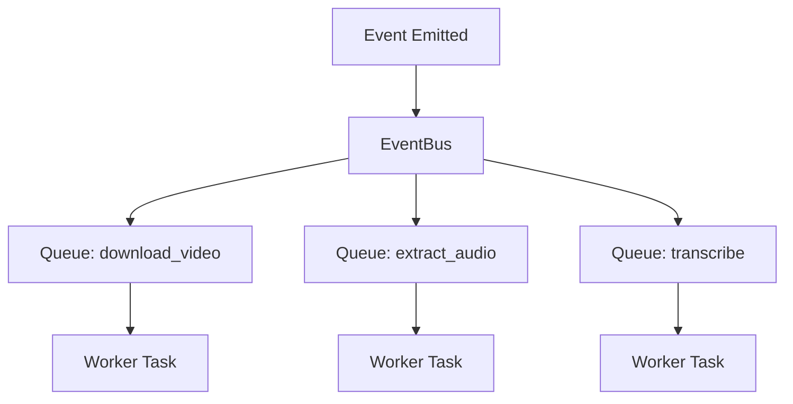

## Internal Mechanism

```text
ONE EVENT → COPIED INTO MULTIPLE QUEUES

EventBus
   |
   |-- Queue per handler
   |-- asyncio Workers
   |-- async dispatch tasks
```

## Example Flow

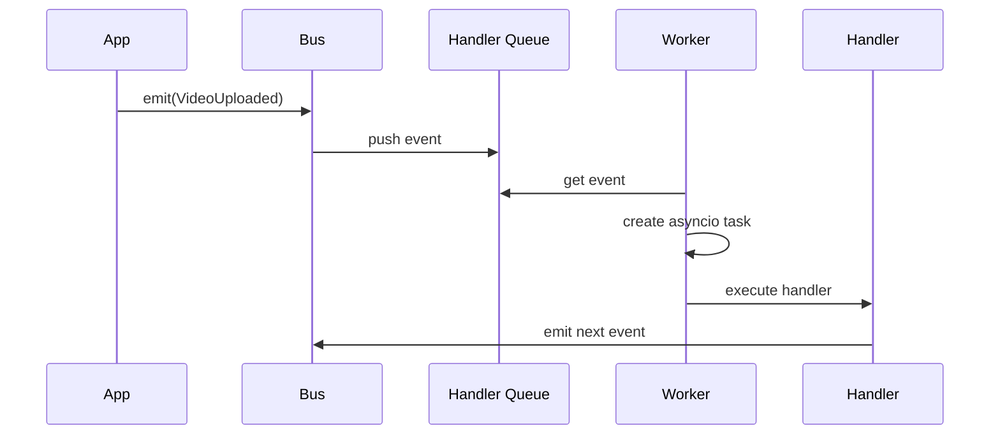

---

# 3. Kafka Architecture (Distributed Event Log)

## Core Flow

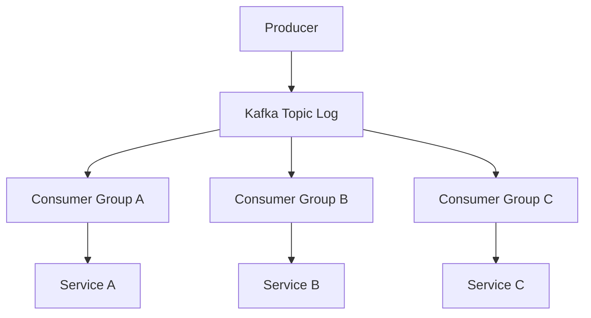

## Internal Storage Model

```text
Kafka Topic = Append-only Log

Offset 100 → VideoUploaded
Offset 101 → VideoDownloaded
Offset 102 → AudioExtracted
```

## Consumer Offset Tracking

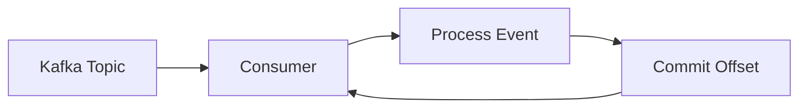

---

# 4. Celery Architecture (Distributed Task Queue)

## Core Flow

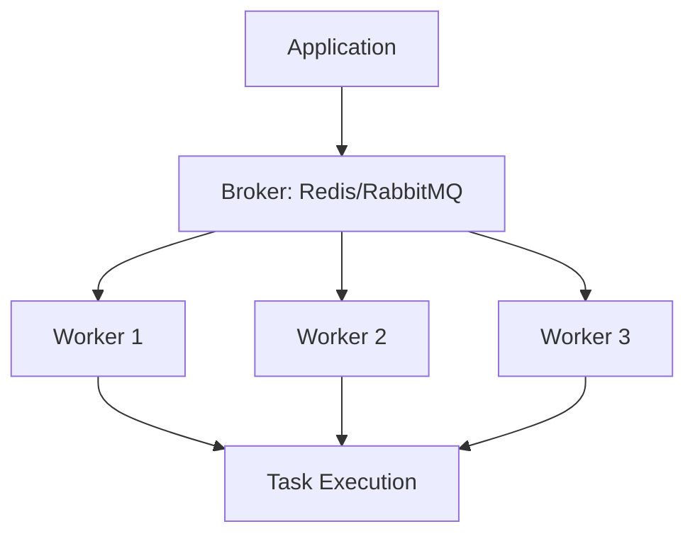

## Task Execution Model

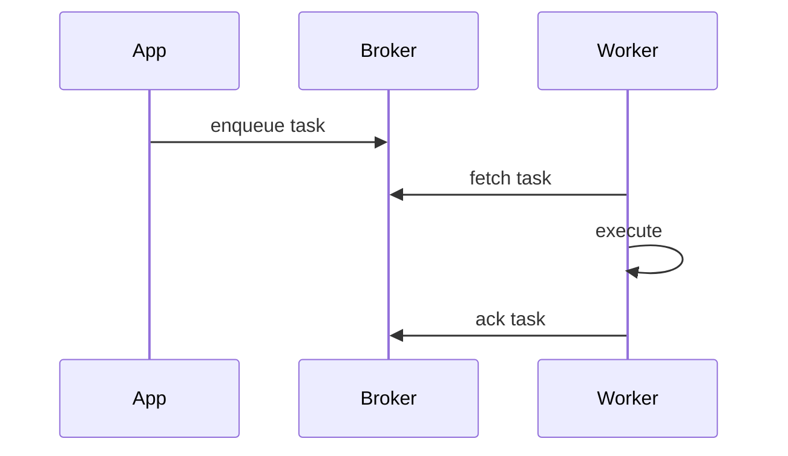

---

# 5. Video Pipeline Comparison (Same Use Case)

## pyeda Flow (Fan-Out Event System)

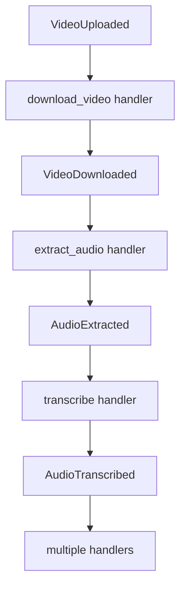

### Key Idea
```text
EVENT TRIGGERS NEXT EVENT (CHAIN)
```

---

## Kafka Flow (Event Log + Consumers)

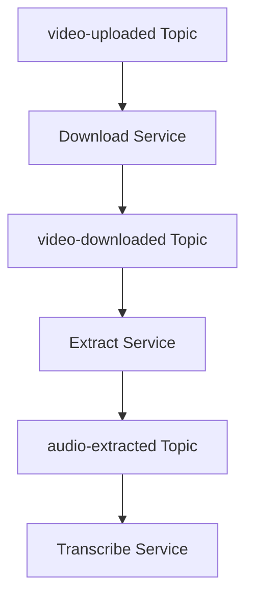

### Key Idea
```text
SERVICES READ LOG + PRODUCE NEW EVENTS
```

---

## Celery Flow (Task Execution)

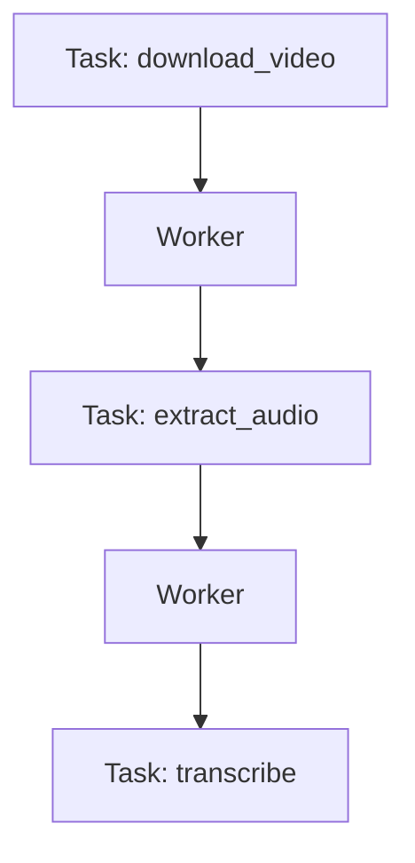

### Key Idea
```text
TASKS FLOW THROUGH BROKER QUEUES
```

---

# 6. Core Architectural Differences

## 6.1 Event Delivery Model

```text
pyeda   → Push into handler queues
Kafka   → Pull from event log (offsets)
Celery  → Pull tasks from broker queue
```

---

## 6.2 Fan-Out Strategy

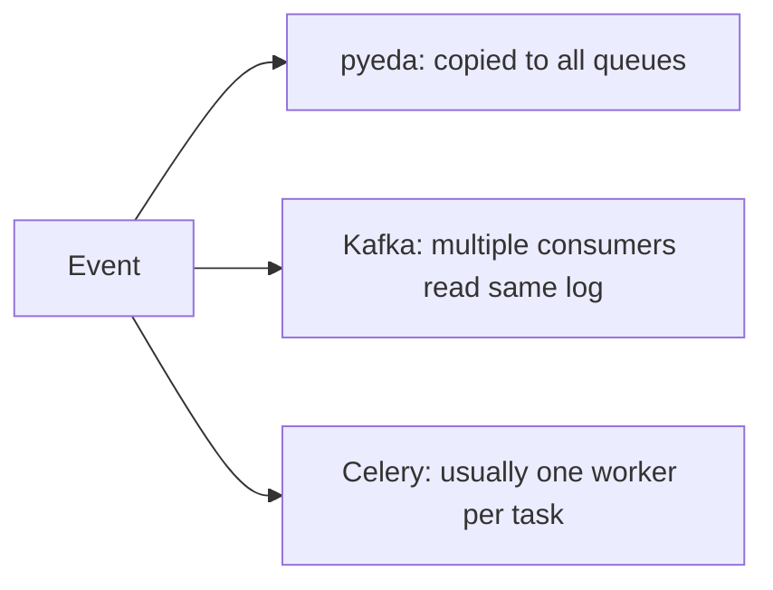

---

## 6.3 Storage Model

```text
pyeda   → in-memory queues (+ optional SQLite)
Kafka   → durable distributed log
Celery  → broker-backed queue storage
```

---

## 6.4 Execution Model

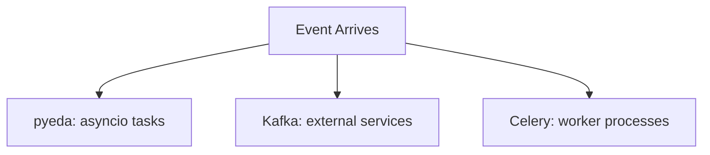

---

# 7. Mental Model Diagrams

## pyeda (Mail Copy System)

```text
Event = letter
Handlers = people
Bus = post office

Post office makes copies and delivers to everyone
```

---

## Kafka (Shared Notebook)

```text
Everyone reads same notebook page
Each reader tracks page number (offset)
```

---

## Celery (Job Queue)

```text
Jobs placed in queue
Workers pick one job at a time
```

---

# 8. Summary View

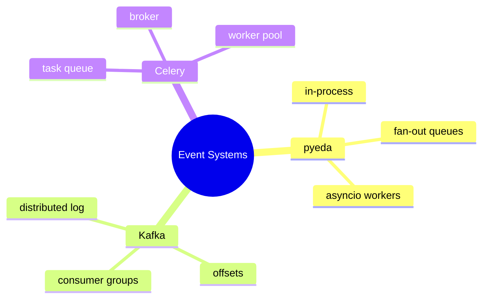

---

# END
